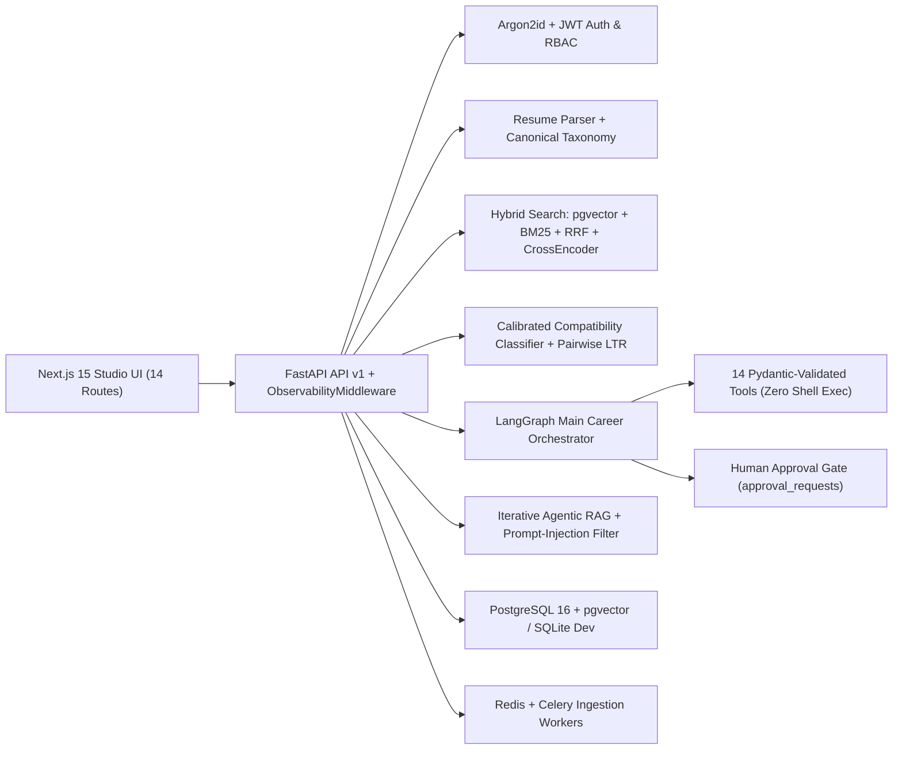
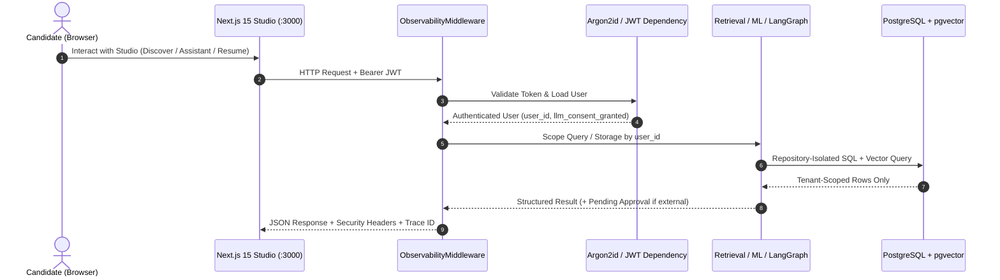
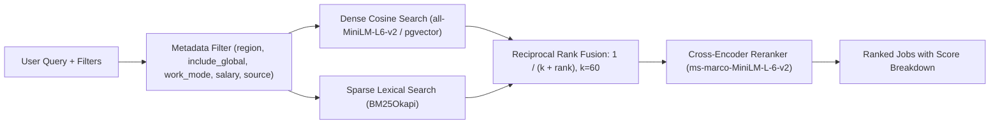
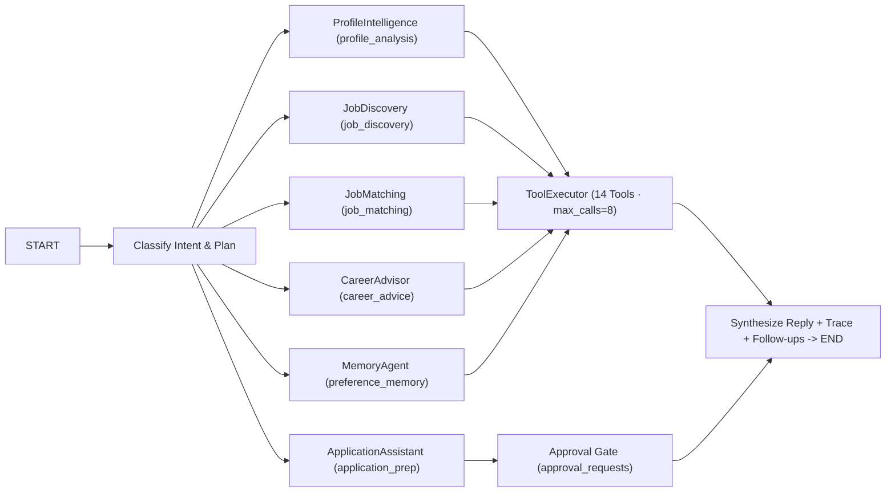
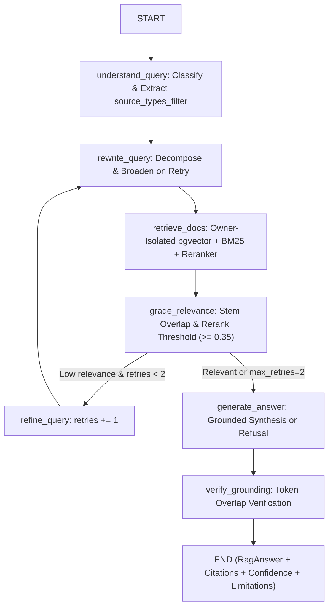

<div align="center">

# Medo — AI Career Intelligence Platform

**Enterprise-Grade Multi-Region Job Discovery, Calibrated ML/LTR Ranking, LangGraph Multi-Agent Orchestration & Cited Agentic RAG**

[](backend/app/main.py)
[](frontend/package.json)
[](backend/app/core/database.py)
[](backend/app/agents/orchestrator.py)
[](backend/app/ranking/ltr.py)
[](backend/app/services/llm_provider.py)
[](.github/workflows/ci.yml)

[Overview](#-overview) · [Architecture](#-system-architecture) · [Live Job Connectors](#-live-job-ingestion--multi-region-normalization) · [Hybrid Search](#-hybrid-retrieval--cross-encoder-reranking) · [ML & LTR](#-calibrated-ml-compatibility--learning-to-rank) · [Agents & RAG](#-langgraph-multi-agent-orchestrator--iterative-rag) · [Security & Privacy](#-security-privacy--human-in-the-loop-governance) · [Database Schema](#-database-schema-25-tables) · [REST API Reference](#-rest-api-v1-reference) · [Frontend Studio](#-14-route-nextjs-15-studio-ui) · [Quick Start](#-quick-start-local-development) · [Docker & Ops](#-docker-compose--production-operations) · [Benchmarks](#-reproducible-evaluation--benchmarks)

</div>

---

> **Human-Controlled by Design**
> - **Explicit Approval Gate (`approval_requests`)**: External job submissions, outbound emails, and external uploads are strictly blocked until explicitly approved by the user.
> - **Consent-Gated External LLMs (`llm_consent_granted`)**: Private resumes and personal details are never sent to external LLM providers without explicit opt-in consent.
> - **Zero Hallucinated Skills (`evidence_span`)**: Candidate skills extracted from resumes require verbatim evidence spans from source text and canonical taxonomy mapping.
> - **Zero Fabricated Metrics**: Every dashboard KPI, funnel count, and compatibility probability is computed directly from persisted database rows and reproducible evaluations.

---

## Table of Contents

1. [Overview](#overview)
2. [System Architecture](#system-architecture)
3. [Live Job Ingestion & Multi-Region Normalization](#live-job-ingestion--multi-region-normalization)
4. [Hybrid Retrieval & Cross-Encoder Reranking](#hybrid-retrieval--cross-encoder-reranking)
5. [Resume Intelligence & Canonical Skill Taxonomy](#resume-intelligence--canonical-skill-taxonomy)
6. [Calibrated ML Compatibility & Learning-to-Rank](#calibrated-ml-compatibility--learning-to-rank)
7. [LangGraph Multi-Agent Orchestrator & Iterative RAG](#langgraph-multi-agent-orchestrator--iterative-rag)
8. [Three-Tier Memory & Human-in-the-Loop Governance](#three-tier-memory--human-in-the-loop-governance)
9. [Security, Privacy & PII-Redacted Observability](#security-privacy--pii-redacted-observability)
10. [Database Schema (25 Tables)](#database-schema-25-tables)
11. [REST API v1 Reference](#rest-api-v1-reference)
12. [14-Route Next.js 15 Studio UI](#14-route-nextjs-15-studio-ui)
13. [Quick Start (Local Development)](#quick-start-local-development)
14. [Environment Configuration Reference](#environment-configuration-reference)
15. [Docker Compose & Production Operations](#docker-compose--production-operations)
16. [Reproducible Evaluation & Benchmarks](#reproducible-evaluation--benchmarks)
17. [Architecture Decision Log (`ADR-001`–`ADR-011`)](#architecture-decision-log-adr-001adr-011)
18. [Project Structure](#project-structure)
19. [Troubleshooting](#troubleshooting)

---

## Overview

**Medo** is a full-stack AI Career Intelligence operating system engineered with verifiable ML pipelines, hybrid dense + sparse retrieval, bounded multi-agent orchestration, and multi-tenant isolation. Rather than relying on opaque LLM prompts for scoring or fabrication-prone extraction, Medo separates deterministic ML ranking, canonical skill grounding, and consent-gated LLM synthesis into auditable layers.

### Key Architectural Highlights

| Dimension | Implementation | Key Files |
| :--- | :--- | :--- |
| **Backend API** | FastAPI + Pydantic v2 + SQLAlchemy 2.0 + Alembic | [`backend/app/main.py`](backend/app/main.py) |
| **Frontend Studio** | Next.js 15 App Router + TypeScript + Tailwind CSS v4 (14 routes) | [`frontend/src/app/page.tsx`](frontend/src/app/page.tsx) |
| **Database & Vectors** | PostgreSQL 16 + `pgvector` HNSW (`VECTOR`) with SQLite local fallback | [`backend/app/core/database.py`](backend/app/core/database.py) |
| **Live Job Ingestion** | 6 free no-key APIs (`Himalayas`, `Jobicy`, `Remotive`, `RemoteOK`, `Arbeitnow`, `HackerNews`) + `Adzuna` + `Apify` | [`backend/app/ingestion/connectors.py`](backend/app/ingestion/connectors.py) |
| **Hybrid Retrieval** | Sentence Transformers (`all-MiniLM-L6-v2`) + `BM25Okapi` + `RRF(k=60)` + `CrossEncoder` | [`backend/app/retrieval/hybrid.py`](backend/app/retrieval/hybrid.py) |
| **ML & LTR Ranking** | 12 interpretable features, `GroupShuffleSplit`, calibrated classifiers, `PairwiseTorchRanker` & GBDT | [`backend/app/ranking/ltr.py`](backend/app/ranking/ltr.py) |
| **Multi-Agent System** | LangGraph `StateGraph` orchestrator routing 6 specialists & 14 Pydantic tools | [`backend/app/agents/orchestrator.py`](backend/app/agents/orchestrator.py) |
| **Iterative Agentic RAG** | Query understanding, decomposition, relevance grading, bounded retries, citation verification | [`backend/app/rag/pipeline.py`](backend/app/rag/pipeline.py) |
| **LLM Providers** | Free local **Ollama**, **DeepSeek**, **OpenAI**, **Anthropic Claude**, `openai_compat`, and offline `mock` | [`backend/app/services/llm_provider.py`](backend/app/services/llm_provider.py) |
| **Observability** | OpenTelemetry spans, route latency percentiles, structured JSON logs with automatic PII redaction | [`backend/app/core/observability.py`](backend/app/core/observability.py) |
| **Background Workers** | Redis 7 + Celery Worker + Celery Beat scheduled ingestion & expiry | [`backend/app/workers/celery_app.py`](backend/app/workers/celery_app.py) |

---

## System Architecture

### End-to-End Platform Topology



### Multi-Tenant Request & Security Flow



### Portable Dual-Dialect Storage (`ADR-001`)

Medo uses portable SQLAlchemy `TypeDecorator` primitives in [`backend/app/core/database.py`](backend/app/core/database.py):
- **`GUID`**: Compiles to native PostgreSQL `UUID` in production and `CHAR(36)` on local SQLite.
- **`JSONBType`**: Compiles to PostgreSQL `JSONB` (with GIN indexing capability) and `JSON` on SQLite.
- **`VectorType`**: Compiles to `pgvector.sqlalchemy.Vector(dim)` on PostgreSQL (using `<=>` cosine distance and HNSW indexes) and serialized `JSON` float arrays on SQLite with NumPy cosine similarity.

---

## Live Job Ingestion & Multi-Region Normalization

Implemented across [`backend/app/ingestion/connectors.py`](backend/app/ingestion/connectors.py), [`backend/app/ingestion/normalizer.py`](backend/app/ingestion/normalizer.py), and [`backend/app/ingestion/pipeline.py`](backend/app/ingestion/pipeline.py).

### Supported Job Connectors

| Source Key | Connector Class | Auth Required | Regions / Coverage | Notes |
| :--- | :--- | :--- | :--- | :--- |
| `all_free` | Multi-source fan-out | None | India + Global + US + EU + UK | Runs all 6 free connectors concurrently/resiliently with partial-failure tolerance |
| `himalayas` | `HimalayasConnector` | None | India (`IN`) + Worldwide | Queries `himalayas.app/jobs/api/search` with `country=IN` & `locationRestrictions` |
| `jobicy` | `JobicyConnector` | None | India (`IN`) / APAC / US / EU / UK | Queries `jobicy.com/api/v2/remote-jobs` with `geo` filter |
| `remotive` | `RemotiveConnector` | None | Software Dev · Global / US | Queries `remotive.com/api/remote-jobs?category=software-dev` |
| `remoteok` | `RemoteOKConnector` | None | Tech & Remote Worldwide | Queries `remoteok.com/api`, skipping legal header & scoring by keyword tokens |
| `arbeitnow` | `ArbeitnowConnector` | None | Europe (`EU`) / UK / Remote | Queries `arbeitnow.com/api/job-board-api` (Greenhouse/Lever/SmartRecruiters feed) |
| `hackernews` | `HackerNewsConnector` | None | Global / US / Remote | Queries HN Algolia + Firebase `"Ask HN: Who is hiring?"` APIs |
| `adzuna` | `AdzunaConnector` | Free API Key | India (`in`), US (`us`), UK (`gb`), SG (`sg`), DE (`de`) | Official Adzuna REST API (`ADZUNA_APP_ID`, `ADZUNA_APP_KEY`) |
| `apify_linkedin` | `ApifyLinkedInConnector` | Paid Apify Token | `IN`, `US`, `UK`, `EU`, `SG` | Runs `harvestapi~linkedin-job-search` via `run-sync-get-dataset-items` |

### 3-Layer Deduplication, Versioning & Multi-Currency Normalization

1. **Normalization (`NormalisedJob`)**:
   - **Company & Title Normalization**: Strips corporate suffixes (`Inc`, `Ltd`, `Technologies`, `Systems`, `Labs`) and title prefixes/levels (`Senior`, `Staff`, `L5`, `III`) and expands acronyms (`ML` → `machine learning`, `SWE` → `software engineer`, `LLM` → `large language model`).
   - **City Alias & Word-Boundary Region Inference**: Normalizes aliases (`bangalore` → `bengaluru`, `gurgaon` → `gurugram`, `sf` → `san francisco`, `nyc` → `new york`) and infers `IN`, `US`, `UK`, `SG`, `EU`, or `GLOBAL` using word-boundary regexes (preventing substring false positives like `"us"` inside `"Dusseldorf"`).
   - **Multi-Currency Salary Parsing (`parse_salary_multicurrency`)**: Parses Indian **LPA** (`× 100,000`), **Crore** (`× 10,000,000`), `₹`/`INR`, `USD`, `EUR`, `GBP`, `SGD`, and `CAD` into `salary_min`, `salary_max`, `salary_currency`, and `salary_min_usd_eq` (`APPROX_FX_TO_USD`: `USD=1.0`, `INR=0.012`, `EUR=1.08`, `GBP=1.27`, `SGD=0.75`, `CAD=0.73`), preserving raw salary text faithfully.
2. **3-Layer Deduplication (`JobIngestionPipeline._find_duplicate`)**:
   - Layer 1: `(source_id, external_id)` exact match.
   - Layer 2: `application_url` exact match across platforms.
   - Layer 3: `content_hash` (`SHA-256` of `normalize_company|normalize_title|normalize_location`).
3. **Version Diffing & Expiry**:
   - Computes `description_hash`; when a listing changes, increments `current_version`, records field diffs (`title`, `salary`, `description`) in `job_versions`, re-syncs `job_skills`, and refreshes `job_embeddings`.
   - Tracks `job_sources` health (`healthy`, `degraded`, `failing`) and marks stale listings (`> 30 days` unseen or past `expires_at`) as `is_expired = true`.

---

## Hybrid Retrieval & Cross-Encoder Reranking

Implemented in [`backend/app/retrieval/hybrid.py`](backend/app/retrieval/hybrid.py) and [`backend/app/retrieval/reranker.py`](backend/app/retrieval/reranker.py).



- **Three Retrieval Modes**: `hybrid` (Dense + BM25 + RRF), `dense` (semantic vector only), and `bm25` (lexical keyword only).
- **Regional + Global Remote Filtering**: Supports strict regional isolation (`include_global=False`, matching exact `region`) or regional + worldwide remote matching (`include_global=True`, matching `[region, "GLOBAL"]`).
- **Score Transparency**: Every result returns `dense_score`, `bm25_score`, `rrf_score`, `rerank_score`, and `final_score`.

---

## Resume Intelligence & Canonical Skill Taxonomy

Implemented in [`backend/app/services/resume_service.py`](backend/app/services/resume_service.py), [`backend/app/ml/skill_taxonomy.py`](backend/app/ml/skill_taxonomy.py), and [`backend/app/ml/skill_extractor.py`](backend/app/ml/skill_extractor.py).

- **Validated File Uploads**: Accepts `.pdf`, `.docx`, `.md`, and `.txt` up to `MAX_UPLOAD_SIZE_BYTES` (default `10 MB`) with path-traversal sanitization (`sanitize_filename`), MIME checks, and magic-byte verification (`%PDF`, `PK` for DOCX).
- **User-Isolated Storage & SHA-256 Versioning**: Files are stored under `<STORAGE_ROOT>/<user_id>/` and tracked in `resume_versions`.
- **Canonical Skill Normalization**: Maps 150+ aliases (e.g., `React.js` / `ReactJS` → `React`, `k8s` → `Kubernetes`, `scikit learn` → `Scikit-Learn`) to 60+ canonical skills across `language`, `framework`, `library`, `database`, `cloud`, `tool`, `domain`, and `soft_skill`.
- **Strict Grounding (`evidence_span`)**: Every extracted `CandidateSkill` stores `proficiency`, `confidence`, `source_section`, and the verbatim `evidence_span` line from the resume—skills are never fabricated.

---

## Calibrated ML Compatibility & Learning-to-Rank

Implemented in [`backend/app/ml/features.py`](backend/app/ml/features.py), [`backend/app/ranking/ltr.py`](backend/app/ranking/ltr.py), and [`backend/app/services/matching_service.py`](backend/app/services/matching_service.py).

### 12 Interpretable Features (`FEATURE_NAMES`)

| # | Feature | Description |
| :--- | :--- | :--- |
| 1 | `semantic_similarity` | Cosine similarity between candidate resume/profile embedding and job embedding |
| 2 | `skill_coverage` | Fraction of all extracted job skills verified in candidate skills |
| 3 | `required_skill_coverage` | Fraction of `required` job skills verified in candidate skills |
| 4 | `experience_fit` | Gaussian/exponential decay curve around `[experience_min_years, experience_max_years]` |
| 5 | `seniority_fit` | Ordinal distance across `intern` → `junior` → `mid` → `senior` → `lead`/`staff` → `principal` |
| 6 | `education_fit` | Ordinal comparison across `unspecified` → `high_school` → `bachelor` → `master` → `phd` |
| 7 | `location_fit` | Remote eligibility, city alias match, or preferred region alignment |
| 8 | `work_mode_fit` | Alignment with preferred `remote` / `hybrid` / `onsite` settings |
| 9 | `job_type_fit` | Alignment with preferred `full-time` / `contract` / `internship` / `part-time` |
| 10 | `salary_fit` | Ratio of normalized `salary_min_usd_eq` against candidate's FX-converted `min_salary` |
| 11 | `recency_score` | Freshness decay from job `posted_at` timestamp |
| 12 | `interaction_affinity` | Persisted implicit/explicit user feedback relevance (`save`, `shortlist`, `dismiss`, `apply`) |

### Model Families & Zero-Leakage Evaluation
- **Compatibility Classifiers**: Sigmoid-calibrated `LogisticRegression`, `RandomForestClassifier`, `GradientBoostingClassifier` (plus `XGBoost` / `LightGBM` on Linux/OpenMP environments).
- **Learning-to-Rank (LTR)**: `BaselineWeightedRanker`, `GradientBoostingRegressor` (pointwise), `PairwiseLinearRanker`, `PairwiseTorchRanker` (PyTorch pairwise margin/logistic ranking loss), plus `XGBRanker` / `LGBMRanker`.
- **Zero-Leakage Splits**: Trained and evaluated using `GroupShuffleSplit` grouped by candidate ID so candidate history never leaks between train, validation, and test sets.
- **Strict Separation**: Deterministic ML probabilities (`compatibility_probability`, `ranking_score`, `ranking_reasons`) are stored in `job_matches` independently of optional, consent-gated `llm_explanation`.

---

## LangGraph Multi-Agent Orchestrator & Iterative RAG

### Dynamic Main Career Orchestrator (`backend/app/agents/orchestrator.py`)



### 14 Pydantic-Validated Tools (`backend/app/agents/tools.py`)

All tools enforce strict Pydantic v2 input validation, bounded call budgets (`max_calls=8`), retry limits, and **zero shell or arbitrary code execution**:

| Tool Name | Purpose | Approval Required |
| :--- | :--- | :--- |
| `search_jobs` | Hybrid search with region, work mode, and job type filters | No |
| `search_jobs_semantically` | Dense vector semantic job search | No |
| `get_candidate_profile` | Load tenant-isolated profile, preferences, and skills | No |
| `analyse_resume` | Inspect primary resume completeness, sections, and gaps | No |
| `calculate_job_match` | Compute calibrated ML compatibility for a specific job | No |
| `rank_jobs` | Rank visible jobs using trained Learning-to-Rank model | No |
| `get_skill_gap` | Compare verified candidate skills vs target job or market demand | No |
| `search_career_knowledge` | Search career guidance & owner-isolated candidate RAG documents | No |
| `generate_cover_letter` | Draft grounded cover letter referencing verified resume skills | No |
| `tailor_resume` | Generate resume tailoring recommendations (LLM gated by consent) | No |
| `track_application` | Create/update drafts; external submission triggers `approval_requests` | External submit: **Yes** |
| `save_job` | Save, shortlist, or dismiss a job & log ranking feedback | No |
| `update_preferences` | Persist confirmed user preference updates | No |
| `get_market_trends` | Compute deterministic skill, salary, and region market demand | No |

### Iterative Agentic RAG Pipeline (`backend/app/rag/pipeline.py`)



- **Owner Isolation**: Private `candidate_doc` chunks are strictly filtered by `owner_user_id == current_user.id`.
- **Prompt-Injection Defense**: Retrieved chunks are scanned/sanitized for injection patterns and enclosed in untrusted-data tags (`<retrieved_evidence>`) before synthesis.
- **Refusal Policy**: When no sufficiently relevant evidence passes grading after `max_retries=2`, returns an explicit insufficiency statement (`confidence=0.15`, `grounded=False`) instead of hallucinating.

---

## Three-Tier Memory & Human-in-the-Loop Governance

Implemented in [`backend/app/memory/service.py`](backend/app/memory/service.py) and [`backend/app/services/approval_service.py`](backend/app/services/approval_service.py):

- **Three-Tier Memory Isolation**:
  - `inferred` vs `confirmed` vs `rejected` (`confirmation_status`).
  - Automatic or LLM-inferred traits **cannot silently overwrite** user-confirmed preferences.
  - Supports soft and hard deletion (`DELETE /api/v1/memory/{memory_id}`) with audit logging.
- **Human-in-the-Loop Approvals (`approval_requests`)**:
  - External actions (`submit_application`, `send_email`, `upload_external`, `irreversible_change`, `share_pii`) create a `pending` approval record and pause execution until the user explicitly approves or rejects via `/privacy` or `/assistant` (`POST /api/v1/approvals/{id}/decide`).

---

## Security, Privacy & PII-Redacted Observability

Implemented in [`backend/app/core/security.py`](backend/app/core/security.py), [`backend/app/core/observability.py`](backend/app/core/observability.py), and [`backend/app/core/rate_limit.py`](backend/app/core/rate_limit.py):

- **Password Hashing**: Argon2id (`argon2-cffi`) with minimum 8-character enforcement.
- **JWT & RBAC**: HS256 Bearer tokens (`ACCESS_TOKEN_EXPIRE_MINUTES=60`) with `get_current_user` and `require_role`. Production (`ENVIRONMENT=production`) rejects weak/default `SECRET_KEY` values and disables `/api/v1/auth/demo` (`403 DEMO_DISABLED`).
- **PII & Secret Log Redaction (`redact_pii`, `redact_mapping`)**: Automatically masks emails (`[REDACTED_EMAIL]`), phone numbers (`[REDACTED_PHONE]`), JWTs (`[REDACTED_JWT]`), API keys (`[REDACTED_API_KEY]`), and sensitive keys (`password`, `token`, `raw_text`, `resume_text`) before emitting structured JSON logs.
- **Security Response Headers**: `X-Content-Type-Options: nosniff`, `X-Frame-Options: DENY`, `Cache-Control: no-store`, and `X-Request-ID` / `X-Trace-ID` correlation headers.
- **OpenTelemetry Tracing**: `ObservabilityMiddleware` + `trace_stage` record per-route latency percentiles (`p50`, `p95`, `max`), stage durations, and token counters.

---

## Database Schema (25 Tables)

Defined in SQLAlchemy 2.0 models ([`backend/app/models/`](backend/app/models/__init__.py)) and versioned via Alembic ([`backend/alembic/`](backend/alembic/env.py)):

```text
users (tenant root)
 ├──< candidate_profiles
 │     ├──< resume_versions
 │     └──< candidate_skills >── skills ──< skill_aliases
 ├──< user_preferences
 ├──< saved_jobs >── jobs
 ├──< applications >── jobs
 │     └──< application_events
 ├──< conversations
 │     └──< messages
 ├──< agent_memory (embedding)
 ├──< approval_requests
 ├──< feedback >── jobs
 ├──< job_matches >── jobs
 └──< audit_logs

job_sources ──< jobs ──< job_versions
                  ├──< job_skills >── skills
                  └──< job_embeddings >── model_versions

knowledge_documents ──< knowledge_chunks (embedding + tsv)
model_versions ──< evaluation_runs
```

| Domain | Tables | Key Constraints & Isolation |
| :--- | :--- | :--- |
| **Identity & Audit** | `users`, `audit_logs` | Unique `email`; `llm_consent_granted` flag; PII-redacted `metadata_json` |
| **Profile & Skills** | `candidate_profiles`, `resume_versions`, `skills`, `skill_aliases`, `candidate_skills`, `user_preferences` | `user_id` scoped; `UNIQUE(profile_id, skill_id)`; verbatim `evidence_span` |
| **Job Corpus** | `job_sources`, `jobs`, `job_versions`, `job_skills`, `job_embeddings` | `UNIQUE(source_id, external_id)`; `content_hash` dedup; `owner_user_id` for private jobs |
| **ML & Applications** | `job_matches`, `saved_jobs`, `applications`, `application_events`, `feedback` | `UNIQUE(user_id, profile_id, job_id)`; 12 application lifecycle stages |
| **Agents & RAG** | `conversations`, `messages`, `agent_memory`, `approval_requests`, `knowledge_documents`, `knowledge_chunks` | Unique LangGraph `thread_id`; `owner_user_id` isolated chunks |
| **Registry & Eval** | `model_versions`, `evaluation_runs` | `training_data_provenance` (`synthetic_dev` vs `real_feedback` vs `curated_benchmark`) |

---

## REST API v1 Reference

Interactive OpenAPI/Swagger docs are available at **`http://127.0.0.1:8000/docs`** when running locally.

### Health & Auth
| Method | Path | Auth | Purpose |
| :--- | :--- | :--- | :--- |
| `GET` | `/health` | Public | Liveness check (`status`, `app`, `version`, `environment`) |
| `GET` | `/ready` | Public | Readiness check for DB (`pgvector`/SQLite) and Redis |
| `POST` | `/api/v1/auth/register` | Public | Register candidate account + default profile & preferences |
| `POST` | `/api/v1/auth/login` | Public | Authenticate with email/password and issue HS256 JWT |
| `POST` | `/api/v1/auth/demo` | Public (Non-Prod) | Seed & sign into demo workspace (`403` in production) |
| `GET` | `/api/v1/auth/me` | JWT | Return current authenticated user |
| `POST` | `/api/v1/auth/consent` | JWT | Grant or revoke `llm_consent_granted` |

### Profile, Resumes & Preferences
| Method | Path | Auth | Purpose |
| :--- | :--- | :--- | :--- |
| `GET` | `/api/v1/profile` | JWT | Bundle of profile, preferences, extracted skills, and resume versions |
| `PUT` | `/api/v1/profile/preferences` | JWT | Update roles, locations, regions, currency, salary, and work modes |
| `POST` | `/api/v1/profile/resume` | JWT | Upload PDF/DOCX/MD/TXT resume, extract canonical skills + evidence spans |

### Jobs, Ingestion & Hybrid Search
| Method | Path | Auth | Purpose |
| :--- | :--- | :--- | :--- |
| `GET` | `/api/v1/jobs` | JWT | Paginated visible jobs with optional filters |
| `POST` | `/api/v1/jobs` | JWT | Create private user-owned job listing (`owner_user_id`) |
| `POST` | `/api/v1/jobs/search` | JWT | Hybrid (`pgvector` + `BM25` + `RRF` + `CrossEncoder`), `dense`, or `bm25` search with `region` & `include_global` |
| `POST` | `/api/v1/jobs/ingest/live` | JWT | Fetch & ingest live jobs from `all_free`, `himalayas`, `jobicy`, `remotive`, `remoteok`, `arbeitnow`, `hackernews`, `adzuna`, or `apify_linkedin` |
| `POST` | `/api/v1/jobs/ingest/demo` | JWT | Ingest local demo fixture dataset |
| `GET` | `/api/v1/jobs/sources/health` | JWT | Source health status, consecutive failures, and last error telemetry |
| `GET` | `/api/v1/jobs/{job_id}` | JWT | Retrieve single job detail (tenant-checked) |

### ML Matching, Applications & Analytics
| Method | Path | Auth | Purpose |
| :--- | :--- | :--- | :--- |
| `POST` | `/api/v1/jobs/match` | JWT | Compute calibrated ML compatibility & LTR scores (plus optional consent-gated LLM explanation) |
| `GET` | `/api/v1/recommendations` | JWT | Retrieve ranked job recommendations with 12-feature explanations |
| `GET` / `POST` | `/api/v1/applications` | JWT | List or create tracked applications |
| `PATCH` | `/api/v1/applications/{id}` | JWT | Update stage (`draft` → `offer`) and record `application_events` |
| `POST` | `/api/v1/feedback` | JWT | Record explicit/implicit signals (`save`, `shortlist`, `dismiss`, `apply`, `thumbs_up`) |
| `GET` | `/api/v1/analytics` | JWT | Real database KPIs (`total_jobs`, `total_saved`, `total_applications`, top skills) |

### Agents, RAG, Memory, Approvals & Observability
| Method | Path | Auth | Purpose |
| :--- | :--- | :--- | :--- |
| `POST` | `/api/v1/agent/chat` | JWT | Run LangGraph Main Career Orchestrator and persist thread history |
| `GET` | `/api/v1/conversations` | JWT | List user's orchestrator sessions |
| `GET` | `/api/v1/conversations/{id}` | JWT | Load conversation messages, execution steps, and token usage |
| `POST` / `GET` | `/api/v1/rag/documents` | JWT | Index or list user-isolated private knowledge documents |
| `POST` | `/api/v1/rag/query` | JWT | Execute Iterative Agentic RAG with citations & grounding verification |
| `GET` / `POST` | `/api/v1/memory` | JWT | List or store 3-tier memory entries |
| `PATCH` / `DELETE` | `/api/v1/memory/{id}` | JWT | Confirm, reject, or delete memory entry |
| `GET` | `/api/v1/approvals` | JWT | List pending/decided HITL approval requests |
| `POST` | `/api/v1/approvals/{id}/decide` | JWT | Approve or reject a gated external action |
| `GET` | `/api/v1/observability/metrics` | JWT | Route latency percentiles, stage timings, and token counters |
| `GET` | `/api/v1/observability/audit-logs` | JWT | User-isolated PII-redacted security audit trail |
| `GET` / `POST` | `/api/v1/evaluation/runs`, `/run` | JWT | Inspect or trigger provenance-tagged evaluation suites |

---

## 14-Route Next.js 15 Studio UI

Built with Next.js 15 App Router, TypeScript, Tailwind CSS v4, and Lucide icons inside [`frontend/src/app/`](frontend/src/app/):

| Route | View | Functionality |
| :--- | :--- | :--- |
| `/` | Studio Landing | Prompt-first command composer + interactive SVG Mermaid architecture & LangGraph flowcharts |
| `/auth` | Authentication | Sign In, Create Account, and non-production Demo Workspace login |
| `/onboarding` | Guided Setup | LLM consent opt-in, target role/region/currency preferences, and initial resume upload |
| `/dashboard` | Career Dashboard | Live DB KPIs, pending HITL approval banner, top calibrated matches, recent jobs |
| `/discover` | Job Discovery | Multi-region search, region pills, `include_global` toggle, live ingestion from 6 free APIs |
| `/jobs/[id]` | Job Inspector | Full normalized job view, on-demand ML match computation, and application draft creation |
| `/recommendations` | ML & LTR Ranker | Calibrated fit probabilities, feature attribution reasons, and feedback signals |
| `/resume` | Resume Intelligence | Drag/upload PDF/DOCX/MD/TXT resumes, inspect parsed sections and `evidence_span` skills |
| `/skills` | Skill-Gap Matrix | Verified skills vs market & target job demand gaps |
| `/roadmap` | Career Roadmap | Structured transition plan derived from profile gaps and role targets |
| `/assistant` | AI Assistant | Dual-mode chat: **LangGraph Orchestrator** (traceable steps + HITL approvals) & **Agentic RAG QA** |
| `/tracker` | Application Pipeline | Stage management (`draft` through `offer`) with event history |
| `/profile` | Preferences | Edit preferred roles, locations, regions, currency, minimum salary, and work modes |
| `/privacy` | Governance & Telemetry | Toggle LLM consent, decide pending approvals, manage 3-tier memory, view OTEL metrics & audit logs |

---

## Quick Start (Local Development)

### Prerequisites
- Python **3.12+**
- Node.js **20+** & `npm`
- *(Optional)* **Ollama** (`brew install ollama`) for free local LLM generation, or **Docker Desktop** for the full Postgres + `pgvector` + Redis stack.

### 1. Backend Setup

```bash
python3 -m venv .venv
source .venv/bin/activate
pip install -r requirements.txt

cp .env.example .env
# Uses SQLite (./data/nexus_dev.db) out of the box

alembic -c backend/alembic.ini upgrade head
HF_HUB_OFFLINE=1 uvicorn backend.app.main:app --host 127.0.0.1 --port 8000
```

> **Tip:** Run with `HF_HUB_OFFLINE=1` once `all-MiniLM-L6-v2` and `cross-encoder/ms-marco-MiniLM-L-6-v2` are cached locally to avoid Hugging Face Hub network round-trips.

### 2. Free Local LLM Setup with Ollama (Recommended)

```bash
brew install ollama
ollama serve
```

In a second terminal:

```bash
ollama pull llama3.2
```

Update `.env`:

```env
LLM_PROVIDER=ollama
OLLAMA_BASE_URL=http://localhost:11434/v1
OLLAMA_MODEL=llama3.2
```

*(You can also use `LLM_PROVIDER=deepseek`, `openai`, `anthropic`, `openai_compat`, or `mock` for zero-install offline mode.)*

### 3. Frontend Setup

```bash
cd frontend
npm install
npm run dev
```

Visit **`http://localhost:3000`** (Backend API docs: **`http://127.0.0.1:8000/docs`**).

---

## Environment Configuration Reference

See [`.env.example`](.env.example) for the complete template:

| Variable | Default | Description |
| :--- | :--- | :--- |
| `APP_NAME` | `Medo AI Career Intelligence` | Application display name |
| `ENVIRONMENT` | `development` | `development`, `test`, or `production` (enforces strict guards in prod) |
| `ALLOWED_ORIGINS` | `http://localhost:3000,http://127.0.0.1:3000` | FastAPI CORS allowed browser origins |
| `SECRET_KEY` | `dev-only-...` | HS256 JWT signing key (`>= 32` high-entropy chars required in production) |
| `DATABASE_URL` | `sqlite:///./data/nexus_dev.db` | PostgreSQL (`postgresql+psycopg://...`) or local SQLite URL |
| `REDIS_URL` | `redis://localhost:6379/0` | Optional Redis cache / rate limiter / readiness check |
| `STORAGE_ROOT` | `./data/storage` | Tenant-isolated upload storage directory |
| `EMBEDDING_MODEL_NAME` | `all-MiniLM-L6-v2` | Sentence Transformer model (`all-MiniLM-L6-v2`, `BAAI/bge-base-en-v1.5`, `intfloat/e5-base-v2`) |
| `CROSS_ENCODER_MODEL_NAME` | `cross-encoder/ms-marco-MiniLM-L-6-v2` | Cross-encoder reranker model |
| `LLM_PROVIDER` | `mock` | `ollama`, `deepseek`, `openai`, `anthropic`, `openai_compat`, or `mock` |
| `LLM_MODEL` / `LLM_BASE_URL` | `""` | Optional custom model & OpenAI-compatible base URL (e.g., Groq/OpenRouter) |
| `OLLAMA_BASE_URL` / `OLLAMA_MODEL` | `http://localhost:11434/v1` / `llama3.2` | Local Ollama endpoint & model name |
| `DEEPSEEK_API_KEY` / `OPENAI_API_KEY` / `ANTHROPIC_API_KEY` | `""` | Provider API keys |
| `ADZUNA_APP_ID` / `ADZUNA_APP_KEY` | `""` | Optional free Adzuna developer credentials (`IN`/`US`/`UK`/`SG`/`EU`) |
| `APIFY_API_TOKEN` | `""` | Optional Apify token for LinkedIn actor ingestion |
| `OTEL_EXPORTER_OTLP_ENDPOINT` | `""` | Optional OpenTelemetry collector endpoint |

---

## Docker Compose & Production Operations

[`docker-compose.yml`](docker-compose.yml) orchestrates **6 containers**: `postgres` (`pgvector/pgvector:pg16`), `redis` (`redis:7-alpine`), `backend` (FastAPI), `celery_worker`, `celery_beat`, and `frontend` (Next.js 15).

```bash
cp .env.example .env
# Set strong SECRET_KEY (>= 32 chars) and POSTGRES_PASSWORD in .env
docker compose up --build -d
```

- **Database Migrations:** `alembic -c backend/alembic.ini upgrade head`
- **Backup & Restore (`pg_dump` / `pg_restore`):** Documented in [`docs/deployment_and_operations.md`](docs/deployment_and_operations.md)
- **Legacy SQLite Migration (Non-Destructive):** `python -m scripts.migrate_legacy_sqlite --legacy-db data/jobs.db --dry-run`
- **CI Quality Gate ([`.github/workflows/ci.yml`](.github/workflows/ci.yml)):** Runs `python -m compileall`, Alembic `upgrade head`, full `pytest tests/ -v`, offline `backend.app.evaluation.run_all`, `npx tsc --noEmit`, and `npm run build` on every push/PR.

---

## Reproducible Evaluation & Benchmarks

Medo strictly isolates `synthetic_dev`, `curated_benchmark`, and `real_feedback` evaluation runs inside `evaluation_runs` and [`docs/experiments/`](docs/experiments/phase7_evaluation_report.json).

### Compatibility & Learning-to-Rank (`synthetic_dev`, 1,500 grouped pairs, `GroupShuffleSplit`)

| Model | Kind | Key Metrics |
| :--- | :--- | :--- |
| `LogisticRegression` (Calibrated) | Compatibility | **ROC-AUC `0.9787` · F1 `0.9679` · Brier `0.0377` · ECE `0.0335`** |
| `GradientBoostingClassifier` | Compatibility | ROC-AUC `0.9619` · F1 `0.9631` · Brier `0.0501` · ECE `0.0353` |
| `RandomForestClassifier` | Compatibility | ROC-AUC `0.9485` · F1 `0.9517` · Brier `0.0590` · ECE `0.0483` |
| `Pointwise GBR` | LTR Ranker | **NDCG@5 `0.9822` · NDCG@10 `0.9857` · MRR `1.0000` · MAP `0.9904`** |
| `PairwiseTorchRanker` | LTR Ranker | **NDCG@5 `0.9887` · NDCG@10 `0.9853` · MRR `1.0000` · MAP `0.9927`** |
| `PairwiseLinearRanker` | LTR Ranker | NDCG@5 `0.9887` · NDCG@10 `0.9850` · MRR `1.0000` · MAP `0.9926` |

### Agent Orchestrator (`curated_benchmark`, 6 end-to-end scenarios)
- **Task Completion Rate:** `1.00` (`100%`)
- **Tool Selection Accuracy:** `1.00` (`100%`, `0` unnecessary or failed tool calls)
- **Approval Gate Pass Rate:** `1.00` (`100%`)
- **Average Orchestrator Latency:** `162.39 ms`

### Run Test & Evaluation Suites

```bash
# Full backend pytest suite (Phase 1–9)
USE_STUB_EMBEDDINGS=true LLM_PROVIDER=mock .venv/bin/pytest tests/ -v

# Unified offline evaluation suite
HF_HUB_OFFLINE=1 .venv/bin/python -m backend.app.evaluation.run_all

# Frontend type-check & production build
cd frontend && npx tsc --noEmit && npm run build
```

---

## Architecture Decision Log (`ADR-001`–`ADR-011`)

Full rationale and trade-offs are recorded in [`docs/decision_log.md`](docs/decision_log.md):

- **ADR-001:** Portable SQLAlchemy `GUID` / `JSONBType` / `VectorType` for PostgreSQL + `pgvector` and local SQLite
- **ADR-002:** Argon2id + HS256 JWT authentication and explicit `llm_consent_granted` opt-in gate
- **ADR-003:** Grounded `CANONICAL_SKILLS` + `SkillAlias` taxonomy with verbatim `evidence_span` verification
- **ADR-004:** Sentence Transformer embedding evaluation, query/document prefixes, SHA-256 caching, and `ModelVersion` tracking
- **ADR-005:** Multi-currency (`INR` LPA/Crore, `USD`, `EUR`, `GBP`, `SGD`) normalization & Hybrid RRF + Cross-Encoder retrieval
- **ADR-006:** Interpretable 12-feature ML compatibility & LTR separation from optional LLM explanations
- **ADR-007:** Dynamic LangGraph Career Orchestrator across 6 specialists and 14 bounded Pydantic tools
- **ADR-008:** Iterative Agentic RAG, 3-tier memory (`inferred` vs `confirmed`), and `approval_requests` HITL gate
- **ADR-009:** Structured PII-redacted JSON logging, OpenTelemetry spans, and provenance-tagged evaluations
- **ADR-010:** Direct client API routing in local development & full 14-route Studio integration
- **ADR-011:** 6-container Docker Compose topology & automated GitHub Actions CI gate

---

## Project Structure

```text
Medo/
├── .github/workflows/ci.yml        # Automated backend pytest + eval + frontend build CI
├── .env.example                    # Environment template (Ollama, DeepSeek, OpenAI, Claude, Adzuna, Apify)
├── Dockerfile                      # Hardened non-root backend & Celery worker image
├── docker-compose.yml              # 6-service stack (Postgres+pgvector, Redis, API, Worker, Beat, Next.js)
├── pyproject.toml                  # Python project & pytest configuration
├── requirements.txt                # Backend ML, FastAPI, LangGraph, and SQLAlchemy dependencies
├── backend/
│   ├── alembic.ini                 # Alembic migration configuration
│   ├── alembic/                    # Database migration scripts & env
│   └── app/
│       ├── main.py                 # FastAPI app factory, CORS, middleware & router registration
│       ├── agents/                 # LangGraph orchestrator, 6 specialists, 14 Pydantic tools
│       ├── api/v1/                 # Auth, profile, jobs, recommendations, agent, RAG, memory, approvals, telemetry
│       ├── auth/                   # Argon2id hashing, JWT dependencies & service
│       ├── core/                   # Settings, DB types, AppError handlers, rate limiter, OTEL + PII redaction
│       ├── evaluation/             # Embedding, retrieval, ML/LTR, RAG, and Agent benchmark suites
│       ├── ingestion/              # 8 job connectors, normalizer, 3-layer dedup, job versioning & expiry
│       ├── memory/                 # 3-tier persistent memory service
│       ├── ml/                     # Embeddings, skill extractor, canonical taxonomy, 12-feature builder
│       ├── models/                 # SQLAlchemy 2.0 ORM definitions (25 tables)
│       ├── rag/                    # Iterative LangGraph RAG pipeline, knowledge seeding & retriever
│       ├── ranking/                # Calibrated classifiers, LTR models & IR metrics (NDCG/MRR/MAP/ECE)
│       ├── repositories/           # User-isolated data access repositories
│       ├── retrieval/              # Hybrid dense + BM25 + RRF + CrossEncoder reranker
│       ├── schemas/                # Pydantic v2 request/response schemas
│       ├── services/               # Analytics, approvals, LLMProvider, matching, resume parsing
│       └── workers/                # Celery app & scheduled background tasks
├── frontend/
│   ├── Dockerfile                  # Production Next.js 15 container
│   ├── next.config.ts              # API origin proxy rewrites
│   ├── package.json                # Next.js 15, React 19, Tailwind CSS v4, Lucide
│   └── src/
│       ├── app/                    # 14 App Router pages (/, /auth, /discover, /dashboard, /assistant, etc.)
│       ├── components/             # StudioShell & interactive SVG Mermaid ArchitectureDiagrams
│       └── lib/api.ts              # Typed API client & token session helpers
├── docs/
│   ├── architecture_audit.md       # System audit & gap closure review
│   ├── database_schema.md          # Complete 25-table PostgreSQL + pgvector specification
│   ├── decision_log.md             # ADR-001 through ADR-011
│   ├── deployment_and_operations.md# Backup, restore, migration, and worker ops guide
│   └── experiments/                # Saved ML/LTR & Phase 7 reproducible JSON reports
├── scripts/
│   └── migrate_legacy_sqlite.py    # Non-destructive legacy SQLite importer
└── tests/                          # Phase 1–9 pytest unit, integration, security & E2E suites (34 tests)
```

---

## Troubleshooting

- **`[Errno 48] address already in use` on port `8000` or `3000`**:
  ```bash
  lsof -nP -iTCP:8000 -sTCP:LISTEN
  kill <PID>
  ```
- **`__webpack_modules__[moduleId] is not a function` in browser**:
  Stop the Next.js server (`Ctrl+C`), remove `.next`, restart `npm run dev`, and hard-refresh (`Cmd + Shift + R`):
  ```bash
  cd frontend && rm -rf .next && npm run dev
  ```
- **`ollama pull` DNS error (`lookup registry.ollama.ai: no such host`)**:
  Quit the Ollama app (`pkill -f ollama`), start `ollama serve` fresh after your network connects (or set DNS to `1.1.1.1` / `8.8.8.8`), then run `ollama pull llama3.2`.
- **India filter shows fewer local listings**:
  Enable **Include Global Remote roles** in `/discover` to combine `IN` jobs with `GLOBAL` remote openings, fetch via **Himalayas** / **Jobicy**, or add free **Adzuna India** keys (`ADZUNA_APP_ID`, `ADZUNA_APP_KEY`) in `.env`.
- **Slow first search on `/discover`**:
  Prefix `uvicorn` with `HF_HUB_OFFLINE=1` once Hugging Face models are cached locally.
