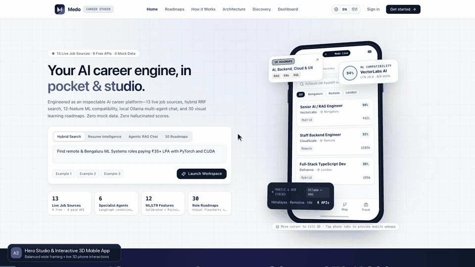
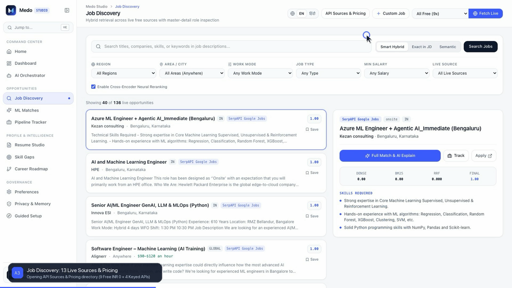
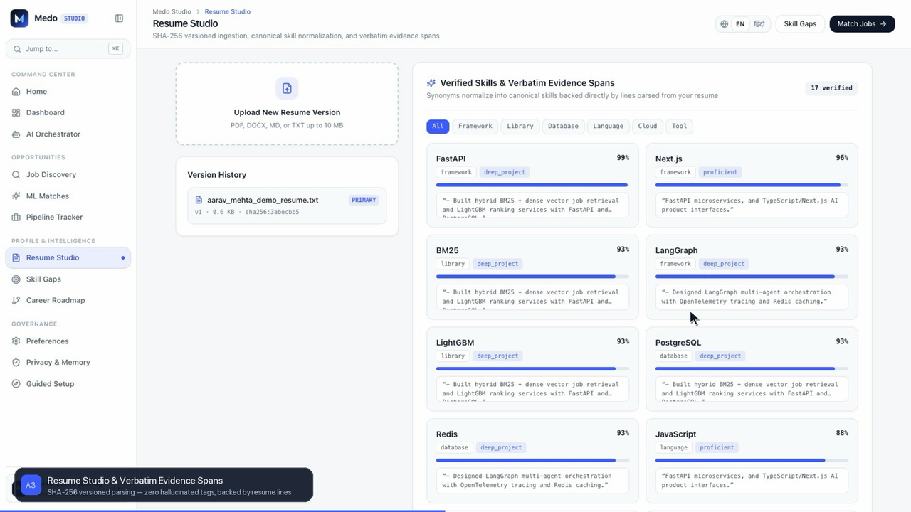
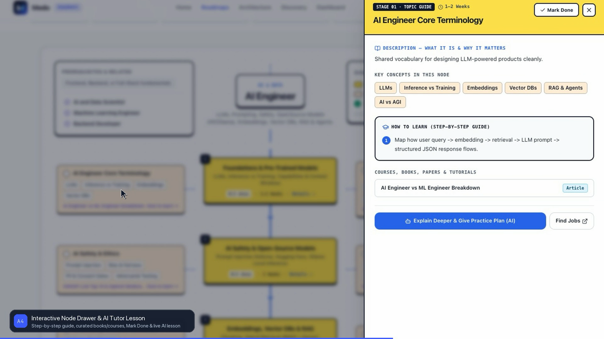
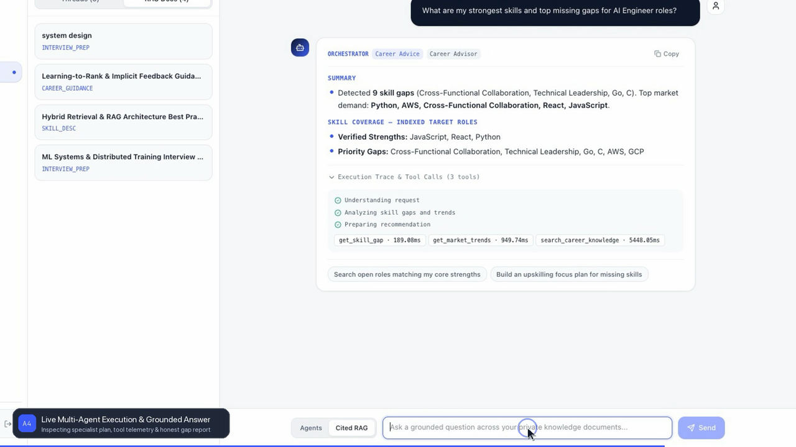
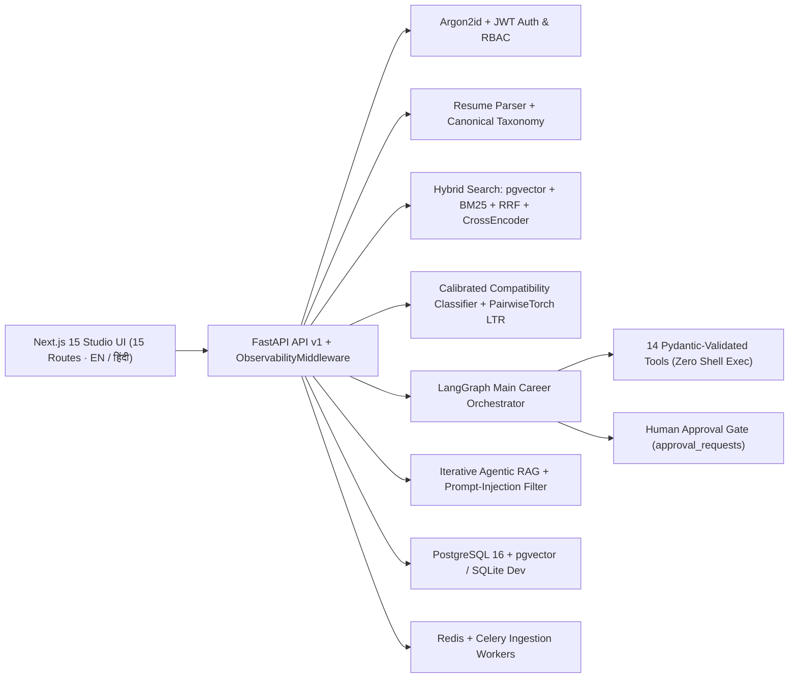
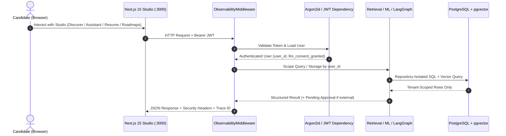
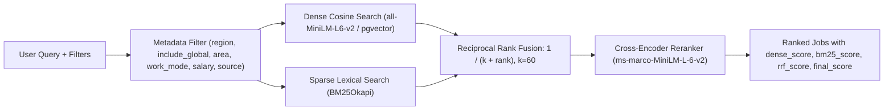
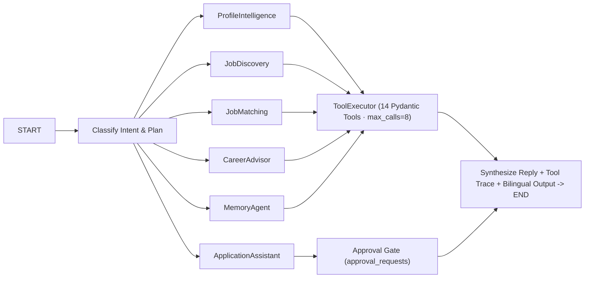

<div align="center">

# Medo — AI Career Intelligence Studio

**Open-Source Multi-Source Job Discovery · Calibrated ML & PyTorch LTR Ranking · 6-Agent LangGraph Orchestrator · Cited RAG · 30 Interactive Roadmaps · Bilingual `EN | हिंदी`**

[](backend/app/main.py)
[](frontend/package.json)
[](backend/app/core/database.py)
[](backend/app/agents/orchestrator.py)
[](backend/app/ranking/ltr.py)
[](https://github.com/souvik082003/Medo/actions/workflows/ci.yml)

[Watch Demo](#-live-product-walkthrough-4m-26s) · [Visual Gallery](#-studio-feature-gallery) · [Why Medo](#-the-problem--engineering-standard) · [Architecture](#-system-architecture) · [13 Job APIs](#-live-job-ingestion-13-api-connectors) · [ML & LTR](#-calibrated-ml--learning-to-rank) · [30 Roadmaps](#-15-route-nextjs-15-studio-ui) · [Quick Start](#-quick-start-local-development)

</div>

---

## Live Product Walkthrough (4m 26s)

<div align="center">

[](docs/media/medo-portfolio-demo.mp4)

**[▶ Download / Play Full 4m 26s Portfolio Walkthrough MP4 (`docs/media/medo-portfolio-demo.mp4` · 35 MB)](docs/media/medo-portfolio-demo.mp4)**

</div>

| Act | What the Walkthrough Demonstrates |
| :--- | :--- |
| **Act 01 · The Problem** | Why stale job boards, black-box LLM scores, and unverified skill claims fail engineers |
| **Act 02 · The Solution (`/` Home)** | Interactive 3D Mobile Webapp (`Bengaluru` / `Remote` / `AI` / `Map` / `Track`), Studio Composer, Deep Walkthrough, & Architecture Matrix |
| **Act 03 · Inside The Engine** | Live Search typing (`PyTorch`, `FastAPI` **Exact in JD**, **Smart Hybrid**), 13 API Pricing Catalog, `/jobs/[id]` brief, Calibrated ML Matches, & Resume Evidence Spans |
| **Act 04 · Learn & Reason** | Skill-Gap Radar, Personal Roadmap, 30 Interactive Roadmaps + AI Tutor Drawer, 6-Agent LangGraph live chat + Execution Trace, & live **`EN \| हिंदी`** switch |
| **Act 05 · Privacy & Governance** | Application Pipeline Tracker (`Board` & `Table`), Candidate Preferences, Consent Opt-In, 3-Tier Memory, OpenTelemetry Traces, & HITL Approvals |
| **Act 06 · The Conclusion** | End-to-end verifiable engineering metrics (`13 Live APIs · ROC-AUC 0.979 · NDCG@10 0.986 · 100% HITL Safety`) |

---

## Studio Feature Gallery

<table>
  <tr>
    <td width="50%">
      <b>13-Source Hybrid Job Discovery (<code>/discover</code>)</b><br/>
      
      <br/><sub>Dense + BM25 + RRF(k=60) + CrossEncoder reranking with SerpAPI Google Jobs, JSearch RapidAPI & 9 free APIs.</sub>
    </td>
    <td width="50%">
      <b>Resume Studio & Evidence Spans (<code>/resume</code>)</b><br/>
      
      <br/><sub>SHA-256 versioned ingestion mapping 150+ aliases to canonical skills backed by verbatim resume quotes.</sub>
    </td>
  </tr>
  <tr>
    <td width="50%">
      <b>30 Interactive Developer Roadmaps (<code>/roadmaps</code>)</b><br/>
      
      <br/><sub>Visual role flowcharts with step-by-step learning guides, books/courses, progress checkmarks & AI tutor.</sub>
    </td>
    <td width="50%">
      <b>6-Agent LangGraph + Execution Trace (<code>/assistant</code>)</b><br/>
      
      <br/><sub>Bounded 14-tool supervisor with live latency telemetry, Cited Agentic RAG & bilingual Hindi/English support.</sub>
    </td>
  </tr>
</table>

---

## The Problem & Engineering Standard

Most AI job tools wrap a single prompt around stale listings and guess compatibility percentages without proof. **Medo separates deterministic ML, hybrid retrieval, evidence extraction, and consent-gated AI synthesis into verifiable layers:**

| Engineering Layer | Generic ChatGPT Job Wrapper | Medo Career Studio |
| :--- | :--- | :--- |
| **Live Job Ingestion** | Stale scraped dump or manual paste | **13 Live APIs** (**9 free `₹0`** + **4 keyed**) with 3-layer SHA/URL deduplication |
| **Retrieval Engine** | Single keyword or prompt dump | `pgvector` cosine + `BM25Okapi` + `RRF(k=60)` + `CrossEncoder` + Area/JD filters |
| **Compatibility Scoring** | Hallucinated `%` guess | **12-feature calibrated ML (`ROC-AUC 0.979`) + `PairwiseTorchRanker` (`NDCG@10 0.985`)** |
| **Skill Extraction** | Unverified tag guessing | Canonical taxonomy normalization + **verbatim `evidence_span` quotes** |
| **Career Q&A & Docs** | Uncited LLM text | **Iterative Agentic RAG** with owner isolation, injection scrubbing & citations |
| **Privacy & Safety** | Unbounded auto-send risk | **Consent Gate (`llm_consent_granted`)** + **HITL `approval_requests`** + local **Ollama** |

> **Human-Controlled by Design**
> - **Explicit Approval Gate (`approval_requests`):** External applications, outbound emails, and external uploads are blocked until explicitly approved by the user.
> - **Consent-Gated External LLMs:** Private resumes and career notes never reach cloud LLMs without explicit opt-in consent (runs 100% locally with **Ollama** or `mock` offline mode).
> - **Zero Fabricated Metrics:** Every dashboard KPI, funnel count, and match probability is computed strictly from persisted database rows.

---

## System Architecture

### End-to-End Platform Topology



### Multi-Tenant Request & Security Flow



### Portable Dual-Dialect Storage (`ADR-001`)

Implemented in [`backend/app/core/database.py`](backend/app/core/database.py):
- **`GUID`**: Native PostgreSQL `UUID` in production, `CHAR(36)` on local SQLite.
- **`JSONBType`**: PostgreSQL `JSONB` in production, `JSON` on SQLite.
- **`VectorType`**: `pgvector.sqlalchemy.Vector(dim)` (`<=>` cosine + HNSW) on PostgreSQL, serialized float array + NumPy cosine similarity on SQLite.

---

## Live Job Ingestion (13 API Connectors)

Implemented in [`backend/app/ingestion/connectors.py`](backend/app/ingestion/connectors.py), [`backend/app/ingestion/normalizer.py`](backend/app/ingestion/normalizer.py), and [`backend/app/ingestion/pipeline.py`](backend/app/ingestion/pipeline.py). Query `GET /api/v1/jobs/sources/catalog` at runtime for live configuration status and transparent INR/USD pricing tiers.

| Source Key | Connector Class | Cost / Free Tier | Env Key Required | Coverage & Notes |
| :--- | :--- | :--- | :--- | :--- |
| `all_free` | **Multi-source 9× fan-out** | **₹0 / \$0 Forever Free** | None | Concurrently syncs all 9 free connectors below with graceful partial-failure handling |
| `himalayas` | `HimalayasConnector` | **₹0 / \$0 Free** | None | India (`IN`) + Global remote roles with salary & timezone metadata |
| `jobicy` | `JobicyConnector` | **₹0 / \$0 Free** | None | Remote tech, DevOps, AI/ML & engineering listings (`geo` filtered) |
| `remotive` | `RemotiveConnector` | **₹0 / \$0 Free** | None | Curated software development & data roles |
| `remoteok` | `RemoteOKConnector` | **₹0 / \$0 Free** | None | Worldwide remote startups with salary bands |
| `arbeitnow` | `ArbeitnowConnector` | **₹0 / \$0 Free** | None | Europe (`EU`), UK & visa-sponsored engineering boards |
| `hackernews` | `HackerNewsConnector` | **₹0 / \$0 Free** | None | Official Algolia + Firebase *"Ask HN: Who is hiring?"* threads |
| `themuse` | `TheMuseConnector` | **₹0 / \$0 Free** | None | Global & hybrid software engineering teams (~500 req/hr public API) |
| `workingnomads` | `WorkingNomadsConnector` | **₹0 / \$0 Free** | None | Worldwide remote engineering, cloud & design jobs feed |
| `greenhouse` | `GreenhousePublicConnector` | **₹0 / \$0 Free** | None | Direct official ATS boards: **Anthropic, Stripe, Figma, Databricks, Vercel, Discord** |
| `adzuna` | `AdzunaConnector` | **250 calls/day free** | `ADZUNA_APP_ID`, `ADZUNA_APP_KEY` | Direct regional India (`in`), US (`us`), UK (`gb`), Singapore (`sg`), Germany (`de`) |
| `jsearch_rapidapi` | `JSearchRapidAPIConnector` | **200 req/mo free** (Pro \$25/mo) | `RAPIDAPI_KEY` | Aggregates LinkedIn, Indeed, Glassdoor & ZipRecruiter via `/search-v2` |
| `serpapi_jobs` | `SerpApiGoogleJobsConnector` | **100 searches/mo free** (Dev \$75/mo) | `SERPAPI_API_KEY` | Structured Google Jobs index across Bengaluru, Hyderabad, Pune & global hubs |
| `apify_linkedin` | `ApifyLinkedInConnector` | **\$5/mo free credit** (\$49/mo Starter) | `APIFY_API_TOKEN` | Role & city LinkedIn job extraction via Apify actor |

### 3-Layer Deduplication & Normalization
1. **Multi-Currency Salary Normalization (`parse_salary_multicurrency`)**: Parses Indian **LPA** (`×100,000`), **Crore** (`×10,000,000`), `₹`/`INR`, `USD`, `EUR`, `GBP`, `SGD`, and `CAD` into normalized USD equivalents (`salary_min_usd_eq`) while keeping exact raw pay text.
2. **Word-Boundary Region & City Alias Normalization**: Maps `bangalore` → `bengaluru`, `gurgaon` → `gurugram`, `sf` → `san francisco`, `nyc` → `new york`, preventing false substring matches (`"us"` inside `"Dusseldorf"`).
3. **3-Layer Deduplication & Versioning**: Matches `(source_id, external_id)`, `application_url`, and `SHA-256(company|title|location)` `content_hash`, tracking description diffs in `job_versions` and connector health in `job_sources`.

---

## Hybrid Retrieval & Cross-Encoder Reranking

Implemented in [`backend/app/retrieval/hybrid.py`](backend/app/retrieval/hybrid.py) and [`backend/app/retrieval/reranker.py`](backend/app/retrieval/reranker.py):



- **Three Search Modes**: `Smart Hybrid` (`hybrid`: Dense + BM25 + RRF + CrossEncoder), `Exact in JD` (`bm25` lexical description match), and `Semantic` (`dense` vector cosine recall).

---

## Calibrated ML & Learning-to-Rank

Implemented in [`backend/app/ml/features.py`](backend/app/ml/features.py), [`backend/app/ranking/ltr.py`](backend/app/ranking/ltr.py), and [`backend/app/services/matching_service.py`](backend/app/services/matching_service.py).

- **12 Interpretable Features**: `semantic_similarity`, `skill_coverage`, `required_skill_coverage`, `experience_fit`, `seniority_fit`, `education_fit`, `location_fit`, `work_mode_fit`, `job_type_fit`, `salary_fit`, `recency_score`, and `interaction_affinity`.
- **Zero-Leakage Evaluation (`GroupShuffleSplit`, 1,500 grouped pairs)**:

| Model | Family | Verified Offline Metrics |
| :--- | :--- | :--- |
| `LogisticRegression` (Sigmoid Calibrated) | Compatibility Classifier | **ROC-AUC `0.9787` · F1 `0.9679` · Brier `0.0377` · ECE `0.0335`** |
| `GradientBoostingClassifier` | Compatibility Classifier | ROC-AUC `0.9619` · F1 `0.9631` · Brier `0.0501` · ECE `0.0353` |
| `Pointwise GBR` | LTR Ranker | **NDCG@5 `0.9822` · NDCG@10 `0.9857` · MRR `1.0000` · MAP `0.9904`** |
| `PairwiseTorchRanker` | Neural LTR Ranker | **NDCG@5 `0.9887` · NDCG@10 `0.9853` · MRR `1.0000` · MAP `0.9927`** |

---

## LangGraph Multi-Agent Orchestrator & Iterative RAG

### 6-Specialist Orchestrator & 14 Pydantic Tools



### Iterative Agentic RAG (`backend/app/rag/pipeline.py`)

- **Owner-Isolated Retrieval**: `candidate_doc` chunks are strictly scoped by `owner_user_id == current_user.id`.
- **Prompt-Injection Defense**: Scrubs indirect overrides and isolates context inside `<retrieved_evidence>` tags.
- **Self-Refinement & Grounding Refusal**: Rewrites queries up to `max_retries=2` if relevance scores below `0.35`, and refuses cleanly (`grounded=False`) instead of guessing when evidence is missing.

---

## 15-Route Next.js 15 Studio UI

All routes support instant **English (`EN`) ↔ Hindi (`हिंदी`)** switching via [`LanguageProvider`](frontend/src/lib/i18n.tsx):

| Route | Module | Key Capabilities |
| :--- | :--- | :--- |
| `/` | Studio Landing | Prompt composer, interactive 3D Mobile Webapp, Guided Showcase, Deep Walkthrough, & Architecture Matrix |
| `/roadmaps` | **30 Role Roadmaps** | Interactive flowchart tracks (AI, Backend, Full Stack, DevOps, SQL, AWS, Docker, Mobile, UX) + How-to-Learn & Ollama Tutor |
| `/discover` | Job Discovery | 13 live job APIs, **`API Sources & Pricing`** modal, Smart Hybrid / Exact-in-JD / Semantic search & JD inspector |
| `/jobs/[id]` | Role Intelligence | Normalized specification, compensation/schedule telemetry, on-demand ML compatibility & draft tracking |
| `/dashboard` | Command Center | Candidate Readiness Ring, live DB KPIs, pending approval alerts & multi-source job feed |
| `/recommendations` | ML & LTR Ranker | Calibrated fit %, 12-feature match reasons, region/fit filters & feedback buttons |
| `/resume` | Resume Studio | Drag/upload PDF/DOCX/MD/TXT, SHA-256 versioning & verbatim `evidence_span` skill cards |
| `/skills` | Skill-Gap Radar | Market skill coverage vs verified candidate strengths & missing priority gaps |
| `/roadmap` | Workspace Roadmap | Personalized phase checklist derived dynamically from profile, matches & gaps |
| `/assistant` | AI Assistant | Dual-mode **LangGraph Orchestrator** (14 tools + trace) & **Cited Agentic RAG QA** |
| `/tracker` | Pipeline Tracker | Kanban Board & Table views across `draft → shortlisted → applied → interview → offer` |
| `/onboarding` | Guided Setup | LLM consent opt-in, target role/region/salary preferences & initial resume indexing |
| `/profile` | Preferences | Manage preferred roles, regions, currency, minimum pay & work modes |
| `/privacy` | Governance & Audit | LLM consent switch, HITL `approval_requests`, 3-tier memory & live OpenTelemetry/eval provenance |
| `/auth` | Authentication | Email/password registration, sign-in & non-production Demo Workspace launcher |

---

## Quick Start (Local Development)

### Prerequisites
- Python **3.12+** & Node.js **20+**
- *(Optional)* **Ollama** (`brew install ollama`) for free local LLM synthesis, or **Docker Desktop** for PostgreSQL 16 + `pgvector` + Redis.

### 1. Backend API (`http://127.0.0.1:8000`)

```bash
python3 -m venv .venv
source .venv/bin/activate
pip install -r requirements.txt

cp .env.example .env
alembic -c backend/alembic.ini upgrade head
HF_HUB_OFFLINE=1 .venv/bin/uvicorn backend.app.main:app --host 127.0.0.1 --port 8000 --reload
```

### 2. Local Free LLM with Ollama *(Recommended)*

```bash
brew install ollama
ollama serve
# In another terminal:
ollama pull llama3.2
```

Set inside `.env`:
```env
LLM_PROVIDER=ollama
OLLAMA_BASE_URL=http://localhost:11434/v1
OLLAMA_MODEL=llama3.2
```
*(Also supports `deepseek`, `openai`, `anthropic`, `openai_compat`, or `mock` for zero-LLM offline mode.)*

### 3. Frontend Studio (`http://localhost:3000`)

```bash
cd frontend
npm install
npm run dev
```

---

## Docker Compose & Production Operations

[`docker-compose.yml`](docker-compose.yml) runs **6 services**: `postgres` (`pgvector/pgvector:pg16`), `redis`, `backend`, `celery_worker`, `celery_beat`, and `frontend`.

```bash
cp .env.example .env
# Set strong SECRET_KEY (>= 32 chars) and POSTGRES_PASSWORD
docker compose up --build -d
```

- **CI Gate ([`.github/workflows/ci.yml`](.github/workflows/ci.yml)):** Verifies Python bytecode + FastAPI boot, Alembic migrations (`upgrade head`), offline evaluation benchmark (`backend.app.evaluation.run_all`), `npx tsc --noEmit`, and `npm run build` on every push.

---

## Project Structure

```text
Medo/
├── .github/workflows/ci.yml        # Automated backend compile/alembic/eval + frontend build CI
├── .env.example                    # Env template (Ollama, DeepSeek, OpenAI, Adzuna, RapidAPI, SerpAPI, Apify)
├── docker-compose.yml              # 6-container production stack
├── backend/
│   ├── alembic/                    # Alembic schema migrations (25 tables)
│   └── app/
│       ├── agents/                 # LangGraph orchestrator, 6 specialists & 14 Pydantic tools
│       ├── api/v1/                 # Auth, profile, jobs, recommendations, agent, RAG, memory, approvals, telemetry
│       ├── core/                   # Settings, SQLAlchemy dual-dialect types, security, OTEL + PII redaction
│       ├── evaluation/             # Retrieval, ML/LTR, RAG, and Agent benchmark suites
│       ├── ingestion/              # 13 job connectors, currency/region normalizer, 3-layer dedup
│       ├── memory/                 # 3-tier isolated memory service
│       ├── ml/                     # Embeddings, skill taxonomy/extractor & 12-feature builder
│       ├── models/                 # SQLAlchemy 2.0 ORM definitions (25 tables)
│       ├── rag/                    # Iterative LangGraph RAG pipeline
│       ├── ranking/                # Calibrated classifiers, PairwiseTorchRanker & IR metrics
│       └── retrieval/              # Hybrid dense + BM25 + RRF + CrossEncoder reranker
├── frontend/
│   └── src/
│       ├── app/                    # 15 Next.js 15 App Router routes
│       ├── components/             # StudioShell, MedoHero3D, MedoDeepDive, ArchitectureDiagrams, etc.
│       └── lib/                    # API client, 30 structured roadmaps & EN/हिंदी i18n dictionary
└── docs/
    ├── media/                      # Portfolio walkthrough MP4, preview GIF & showcase PNGs
    ├── architecture_audit.md       # Architecture review & invariants
    ├── database_schema.md          # 25-table PostgreSQL + pgvector spec
    ├── decision_log.md             # ADR-001 through ADR-011
    └── experiments/                # Saved benchmark reports
```

---

## Troubleshooting

- **Port `8000` or `3000` in use:**
  ```bash
  lsof -nP -iTCP:8000 -sTCP:LISTEN
  kill <PID>
  ```
- **Next.js chunk mismatch after switching branches:**
  ```bash
  cd frontend && rm -rf .next && npm run dev
  ```
- **First `/discover` search feels slow:** Prefix `uvicorn` with `HF_HUB_OFFLINE=1` once `all-MiniLM-L6-v2` and `ms-marco-MiniLM-L-6-v2` are cached locally.
